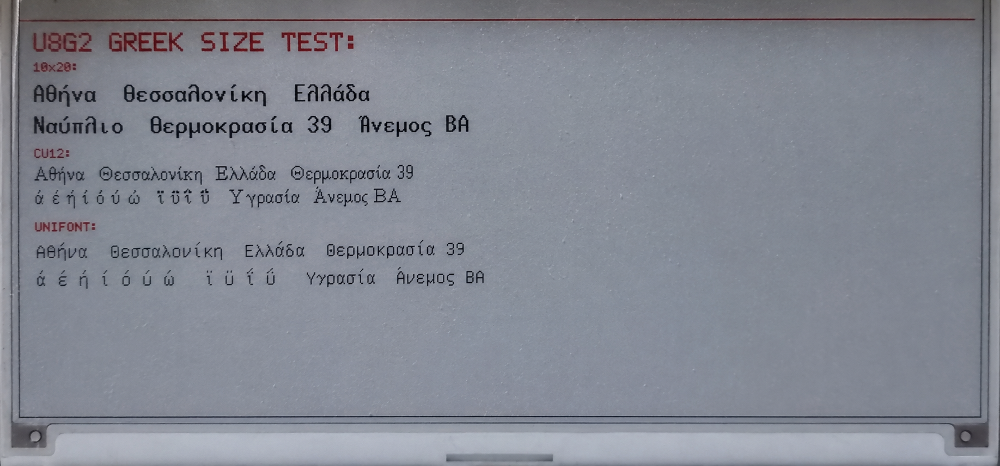

# Greek UTF-8 fonts on 7.5-inch tri-color e-paper

Arduino example for displaying modern Greek UTF-8 text on a Waveshare
7.5-inch E-Paper HAT (B), 800x480, red/black/white (SKU 13505), driven by a
LILYGO T-SIM7080 ESP32-S3.

The example uses `GxEPD2` for the display and `U8g2_for_Adafruit_GFX` for
Unicode Greek text. It also includes a handmade 6x10 comparison renderer.

## Display result



## Ελληνικές οδηγίες

Το παράδειγμα εμφανίζει ελληνικό κείμενο UTF-8 σε οθόνη Waveshare 7.5-inch
E-Paper HAT (B), 800x480, κόκκινο/μαύρο/λευκό (SKU 13505), με πλακέτα
LILYGO T-SIM7080 ESP32-S3.

### Προτεινόμενες γραμματοσειρές

- `u8g2_font_10x20_t_greek`: η καθαρότερη επιλογή για βασικό κείμενο,
  θερμοκρασία, ονόματα και κύριες ενδείξεις.
- `u8g2_font_cu12_t_greek`: μικρότερη γραμματοσειρά για δευτερεύουσες
  πληροφορίες όταν ο διαθέσιμος χώρος είναι περιορισμένος.
- `u8g2_font_unifont_t_greek`: λειτουργεί σωστά, αλλά είναι λεπτότερη και
  λιγότερο ευανάγνωστη από απόσταση.
- Η χειροποίητη 6x10 διατηρείται μόνο για σύγκριση και πειραματισμό.

### Εγκατάσταση

Από το **Library Manager** του Arduino IDE εγκαταστήστε:

1. GxEPD2
2. Adafruit GFX Library
3. U8g2
4. U8g2_for_Adafruit_GFX

Ανοίξτε το `T_SIM7080_7in5b_U8g2_GreekFont_Test.ino`, επιλέξτε
**ESP32S3 Dev Module**, 16 MB Flash, OPI PSRAM και Huge APP και στη συνέχεια
πατήστε **Upload**. Το αρχείο πρέπει να παραμείνει αποθηκευμένο ως UTF-8 για
να μην αλλοιωθούν τα ελληνικά κείμενα.

### Σημαντικό για τα μαύρα κουτάκια

Στη συγκεκριμένη οθόνη, η πρώτη σχεδίαση U8g2 μετά από αλλαγή γραμματοσειράς
μπορεί να εμφανιστεί ως μαύρα ορθογώνια. Ο κώδικας κάνει πρώτα μία προσωρινή
σχεδίαση και καθαρίζει εκείνη την περιοχή του framebuffer. Μην αφαιρέσετε
αυτό το warm-up όταν αλλάζετε μεταξύ 10x20, CU12 και Unifont.

### Συνδεσμολογία

| Σήμα οθόνης | GPIO ESP32-S3 |
|---|---:|
| SCK | 12 |
| MOSI / DIN | 11 |
| CS | 10 |
| DC | 13 |
| RST | 14 |
| BUSY | 21 |
| Τροφοδοσία οθόνης | 47 |

## Tested result

- `u8g2_font_10x20_t_greek`: recommended for primary text. It is the clearest
  and most uniform option on this panel.
- `u8g2_font_cu12_t_greek`: recommended for compact secondary information.
- `u8g2_font_unifont_t_greek`: supported, but thinner and less readable from a
  distance.
- Handmade 6x10: retained only for comparison and experimentation.

The test includes uppercase and lowercase Greek, tonos, dialytika, combined
tonos/dialytika, the degree symbol, and sample weather-station text.

## Hardware

| Signal | ESP32-S3 GPIO |
|---|---:|
| SCK | 12 |
| MOSI / DIN | 11 |
| CS | 10 |
| DC | 13 |
| RST | 14 |
| BUSY | 21 |
| Display power | 47 |

The sketch selects the GxEPD2 panel class `GxEPD2_750c_Z08`.

## Tested library versions

- GxEPD2 1.6.9
- Adafruit GFX Library 1.12.6
- U8g2 2.36.19
- U8g2_for_Adafruit_GFX 1.8.0

Install them with Arduino IDE **Library Manager**. Do not copy the libraries
into this sketch folder and do not replace Adafruit GFX with an old modified
fork.

## Arduino IDE settings

- Board: ESP32S3 Dev Module
- CPU frequency: 240 MHz
- Flash size: 16 MB
- PSRAM: OPI PSRAM
- Partition scheme: Huge APP

Select the correct serial port for the board before uploading.

## Important GxEPD2/U8g2 workaround

On the tested setup, the first U8g2 draw after selecting a different font can
appear as solid black rectangles. The sketch handles this by drawing one
disposable string and clearing that framebuffer area before drawing the real
text. Keep this warm-up step when switching between 10x20, CU12 and Unifont.

## Minimal usage

```cpp
#include <U8g2_for_Adafruit_GFX.h>

U8G2_FOR_ADAFRUIT_GFX u8g2Fonts;

// After display.init(...)
u8g2Fonts.begin(display);
u8g2Fonts.setFontMode(1);
u8g2Fonts.setFontDirection(0);
u8g2Fonts.setForegroundColor(GxEPD_BLACK);
u8g2Fonts.setFont(u8g2_font_10x20_t_greek);
u8g2Fonts.drawUTF8(24, 100, "Θερμοκρασία 39°  Άνεμος ΒΑ");
```

Save the `.ino` and this README as UTF-8 so that the Greek string literals are
preserved.

## Files

- `T_SIM7080_7in5b_U8g2_GreekFont_Test.ino`: complete comparison sketch.
- `GreekFont5x7.h`: handmade comparison font derived from the author's
  [glcdfont_GR-for-YoRadio](https://github.com/arkas80/glcdfont_GR-for-YoRadio)
  project.
- `THIRD_PARTY_LICENSES.md`: library and font attribution.

## Related Greek GFX work

- [glcdfont_GR-for-YoRadio](https://github.com/arkas80/glcdfont_GR-for-YoRadio)
- [johnbacas/GFX_Library](https://github.com/johnbacas/GFX_Library)

These repositories are useful references, but this example does not require a
modified Adafruit GFX installation.

## License

The original example code and handmade font in this repository are released
under the MIT License; see `LICENSE`. Third-party libraries and U8g2 fonts
retain their own licenses; see `THIRD_PARTY_LICENSES.md`.
